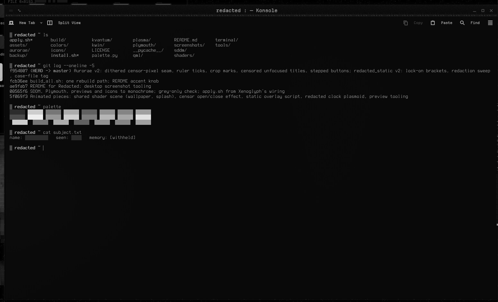

# Redacted — Konsole & kitty Colours

Monochrome-black terminal colours for Konsole and kitty: 16 colours that are all greys, tuned so ls, git and prompts still separate.



Redacted is a monochrome-black look for KDE Plasma 6 about obfuscation and censorship. Every colour is a neutral grey, and the accents sit only a few levels above black: almost imperceptible, but just perceptible. The motifs are static, mosaic pixelation, black censor bars and a dissociated double.

## Features

- Near-black background, grey text, and a grey I-beam cursor.
- All 16 colours are neutral greys at distinct brightness steps, so ls colours, git diffs and prompts still read.
- A Konsole profile with Terminess, a slight translucency and blur, and roomy margins.
- A kitty theme with matching tab and border colours.


## Requirements

Konsole and/or kitty. The profile uses Terminess Nerd Font if it is installed.

## Install

```bash
git clone https://github.com/numbpill3d/redacted-konsole
cd redacted-konsole && ./install.sh
```

Or from the KDE Store: Copy `Redacted.colorscheme` and `Redacted.profile` to `~/.local/share/konsole/`, then pick the profile in Konsole. For kitty, add `include redacted-kitty.conf` to kitty.conf.

## The rest of the suite

| piece | repo |
|---|---|
| Global theme + splash screen | [redacted-global](https://github.com/numbpill3d/redacted-global) |
| Plasma style (panel, popups) | [redacted-plasma](https://github.com/numbpill3d/redacted-plasma) |
| Aurorae window decoration | [redacted-aurorae](https://github.com/numbpill3d/redacted-aurorae) |
| Colour scheme | [redacted-colors](https://github.com/numbpill3d/redacted-colors) |
| Kvantum widget style | [redacted-kvantum](https://github.com/numbpill3d/redacted-kvantum) |
| Icon theme | [redacted-icons](https://github.com/numbpill3d/redacted-icons) |
| SDDM login | [redacted-sddm](https://github.com/numbpill3d/redacted-sddm) |
| Plymouth boot splash | [redacted-plymouth](https://github.com/numbpill3d/redacted-plymouth) |
| Animated wallpaper (desktop + lock) | [redacted-wallpaper](https://github.com/numbpill3d/redacted-wallpaper) |
| Still wallpaper (1080p–4K) | [redacted-image-wallpaper](https://github.com/numbpill3d/redacted-image-wallpaper) |
| KWin open/close effect | [redacted-censor](https://github.com/numbpill3d/redacted-censor) |
| KWin script: active window under review | [redacted-static](https://github.com/numbpill3d/redacted-static) |
| Clock plasmoid | [redacted-clock](https://github.com/numbpill3d/redacted-clock) |

Everything at once, with the generators: [redacted](https://github.com/numbpill3d/redacted).

## Tags

`redacted` `kde` `plasma6` `dark` `black` `monochrome` `grayscale` `minimal` `censored` `glitch` `static` `pixel` `konsole` `kitty` `terminal` `colorscheme` `terminal-theme`

## Credits and licence

By splicer scorn (voidrane). GPL-3.0-or-later.
